# scVizApp_WorkshopMaterial
Welcome to scVizApp Hands-on workshop!!! Materials and Documentation required to follow through scVizApp hands-on workshop are here
## Overview
This platform provides an interactive workspace for exploring summaries of cell types and clusters, interactive plots of gene expression, and access to downstream analyses.

## Modules covered in this workshop
 
| Module | What it does |
|---|---|
| Data upload | Load a Seurat object (.rds) |
| Clustering and UMAP | Explore clusters and conditions |
| Violin / Feature / Dot Plot | Visualize marker gene expression |
| Cluster Annotation | Annotate cell types present in the cohort |
| Module Scoring | Score gene sets (e.g. interferon signaling) |
| Differential Expression | Compare conditions and export results |
 
**Workshop scenario:** "I have a dataset with Control and interferon-beta-stimulated samples. I want to annotate the cell clusters using known marker genes, then score interferon-stimulated gene activity to see which cell types respond most strongly to stimulation compared to Control, followed by differential expression analysis between interferon-beta-stimulated samples vs Control."
 
---
## Quick Links
 
| Resource | Link |
|---|---|
| Access the app | [scVizAppPublic](https://biocoreapps.bsd.uchicago.edu/public/app/scvizapppublic) |
| Input data | [ifnb_demo_seurat.rds](https://drive.google.com/file/d/1ycQC9nTH_2LStd35xSLsVx-erHcFc0Q6/view?usp=sharing) |
| Demo data | [`demo_data/`](demo_data/) |
| Walkthrough tutorial | [`demo_data/README.md`](demo_data/README.md) |
| Slides | [ADD SLIDES LINK](ADD_SLIDES_LINK) |
 
---
## Demo Data
 
| File | Description | Size |
|---|---|---|
| `ifnb_demo_seurat.rds` | Seurat object, Control vs IFN-beta-stimulated | 53MB |
| `demo_data/cell_type_markers.xlsx` | gene list with gene and geneType columns (used in Dot Plot module) | 9KB |
| `demo_data/REACTOME_INTERFERON_SIGNALING.v2026.1.Hs.gmt` | gene set for Module Scoring (used in Scoring module) | 2KB |
 
**Download:** click the file, then choose **Download raw file** (or use the download icon).
 
---
## Walkthrough
 
> **Estimated time:** ~5 minutes for the full workflow.
> Application might crash during the workshop, please **Restart App** if you face any issues.

### Step 1: Load the data
 
**Goal:** Upload the .rds file.
 
1. Access the website link, stay on **Introduction** tab and select the **Load/Input Data** sub-tab.

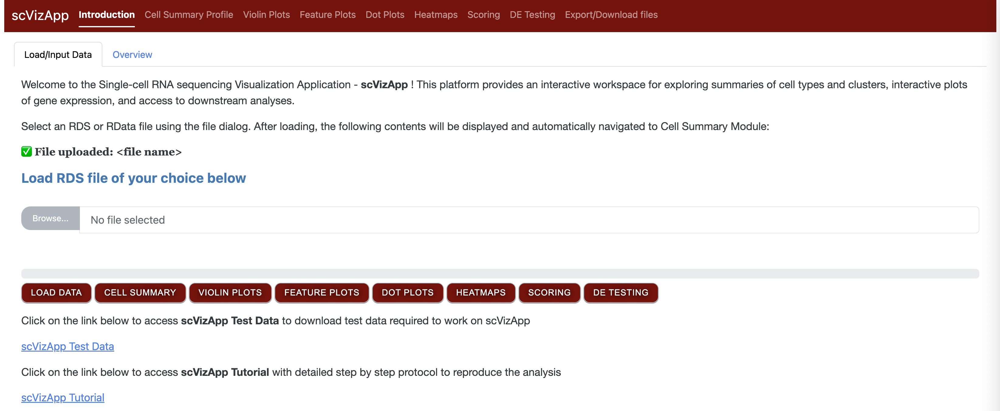
 
2. Download `ifnb_demo_seurat.rds` using the **Input data** link in the Quick Links table.
3. Click **Browse** and select the downloaded file. The progress bar above the button shows the upload from your computer and reads **Upload complete** when it finishes.

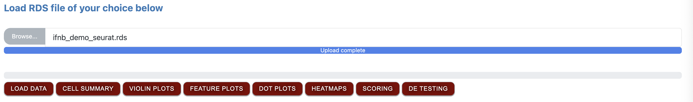

4. Click **Load Data**. A second progress bar tracks the loading. When it finishes, the message **✅ File uploaded: ifnb_demo_seurat.rds** appears.

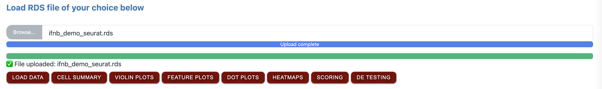
   
5. The app then switches automatically to the **Cell Summary Profile** tab, where you can continue with the analysis.
 
> **Tip:** Files can take up to a minute to load.

### Step 2: Cell Summary Profile
 
**Goal:** Explore cell counts, clusters and conditions present in the cohort.
 
1. This tab contains 3 sub-tabs. **Samples Description** shows the data columns and the values present in each column, for an at-a-glance review of the cohort.

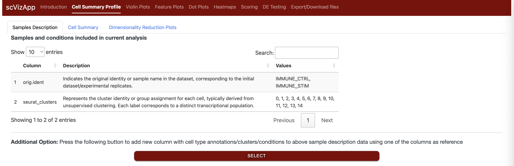
 
2. **Cell Summary** lets you explore cell counts and percentages for any two data columns, in both visual and tabular form.

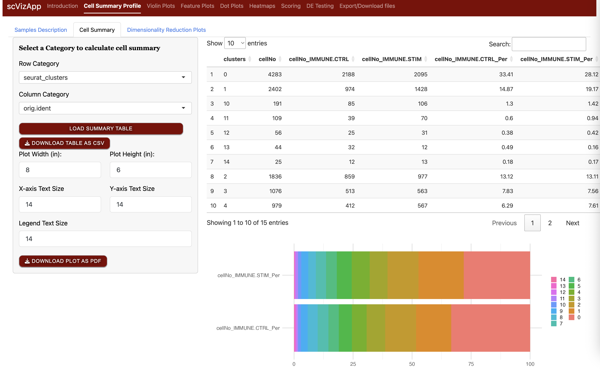

3. In **Dimensionality Reduction Plots**, access PCA and UMAP to understand how cells cluster in the data. Choose a color palette (Default, dittoSeq or Polychrome) to make clusters easier to tell apart.

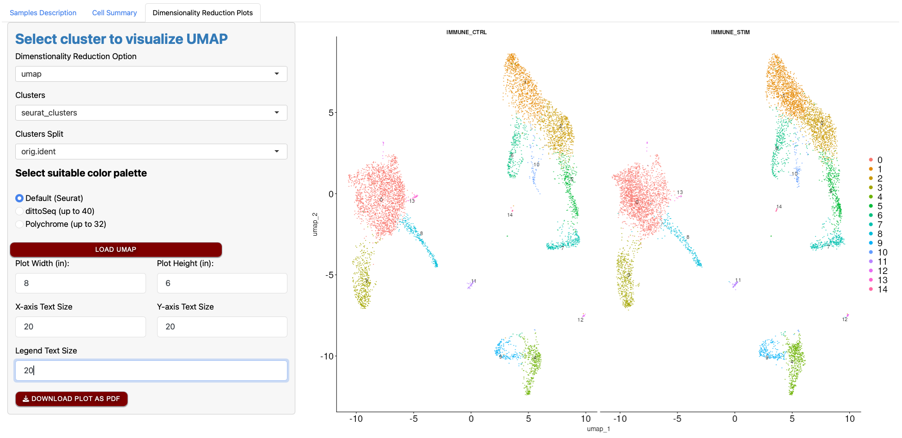

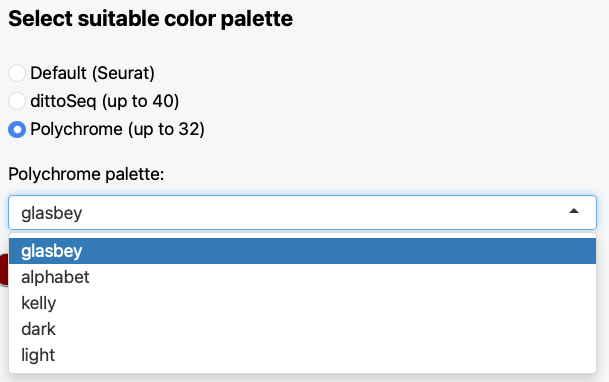

> **Tip:** The **Additional Option** feature on the Samples Description tab is explained in Step 6, after the Dot Plot module.

### Step 3: Violin Plots

**Goal:** Check marker gene expression across clusters.

1. Open the **Violin Plots** tab.
2. In **Select Genes**, choose markers of interest (for example `CD3E`, `CD3D`, `CD4`, `CD8A`, `CD8B`, `PTPRC` for T cells).
3. Set **Clusters to Visualize (x axis)** to `seurat_clusters`. Use **Additional separation** (for example `orig.ident`) to split by condition, or leave it as `None`.
4. Pick a color palette, then click **Load Violin Plot**.
5. Adjust plot width, height and text sizes if needed, and click **Download Plot as PDF** to save the figure.

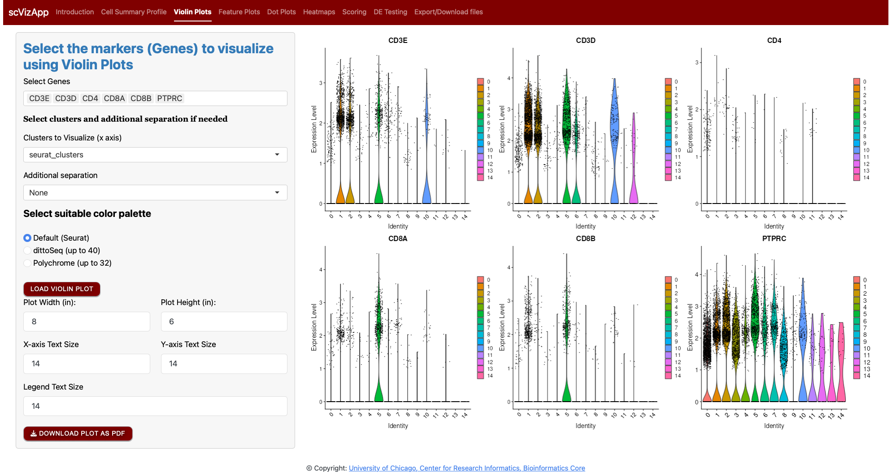

### Step 4: Feature Plots

**Goal:** See where marker genes are expressed on the UMAP.

1. Open the **Feature Plots** tab and select the same genes as in Step 3.
2. Keep **Clusters to Visualize** as `seurat_clusters`. **Additional separation** can split the UMAP by condition.
3. Choose the color scale: **Default (grey → blue)** or **viridis**. Viridis offers several options (viridis, magma, inferno, plasma, cividis, turbo, mako, rocket).
4. Click **Load Feature Plot**.

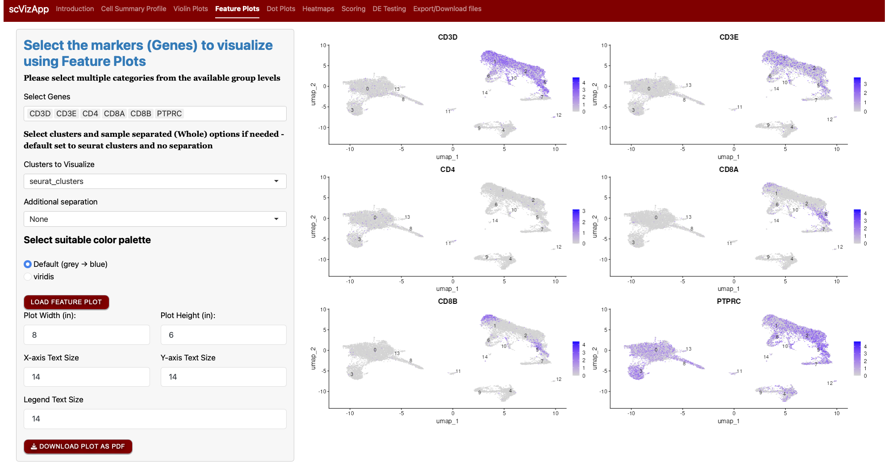

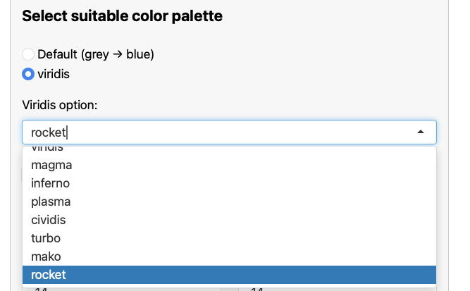

### Step 5: Dot Plots

**Goal:** Use a cell type marker list to identify what each cluster is.

1. Open the **Dot Plots** tab. Under **Choose gene selection source**, there are three options:
   - **From loaded file:** pick genes present in the Seurat object.
   - **From Pre-loaded gene types:** use built-in cell type and cell cycle markers (human only).
   - **From file (with gene & geneType columns):** upload your own marker list.

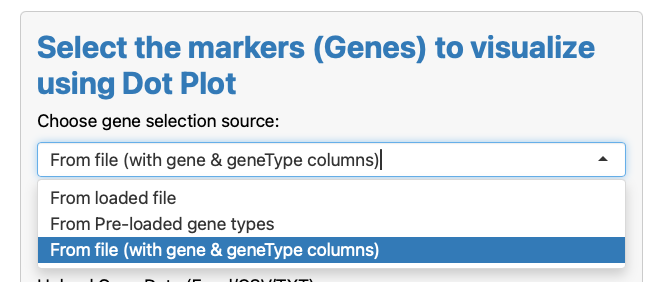

2. Select **From file (with gene & geneType columns)**, click **Browse**, and choose `demo_data/cell_type_markers.xlsx`. Wait for **Upload complete**.

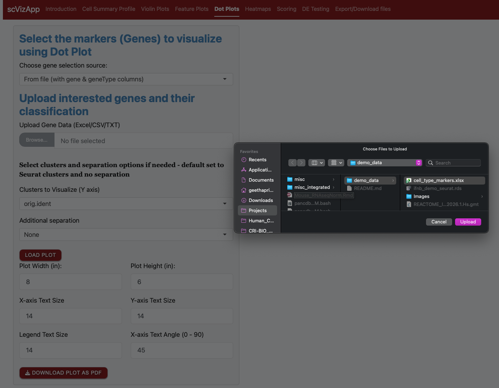

3. Set **Clusters to Visualize (Y axis)** to `seurat_clusters` and click **Load Plot**. The colored bar on top groups the genes by cell type, so you can match each cluster to the cell type whose markers it expresses most strongly.

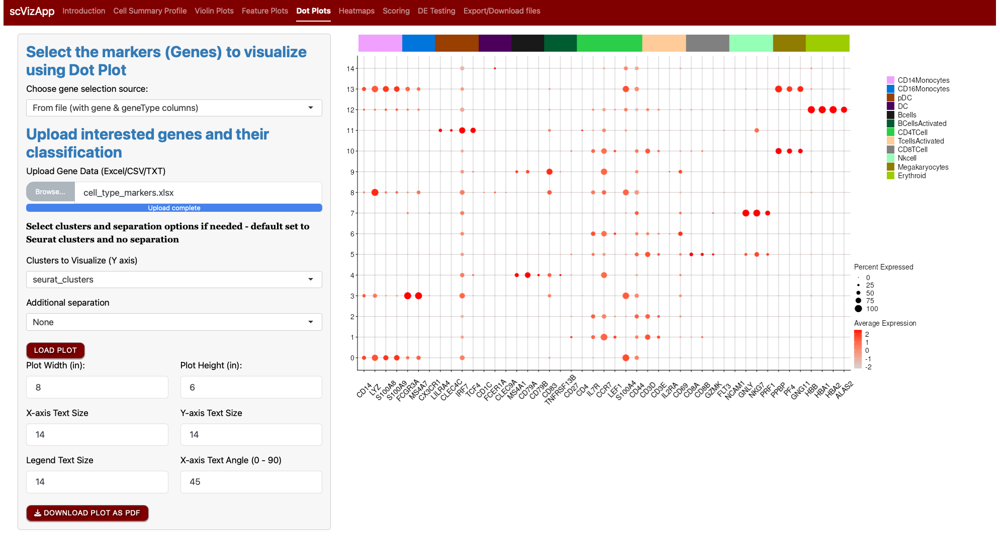

4. To compare conditions, set **Additional separation** to `orig.ident` and click **Load Plot** again. Each cluster now appears twice, once for `IMMUNE_CTRL` and once for `IMMUNE_STIM`.

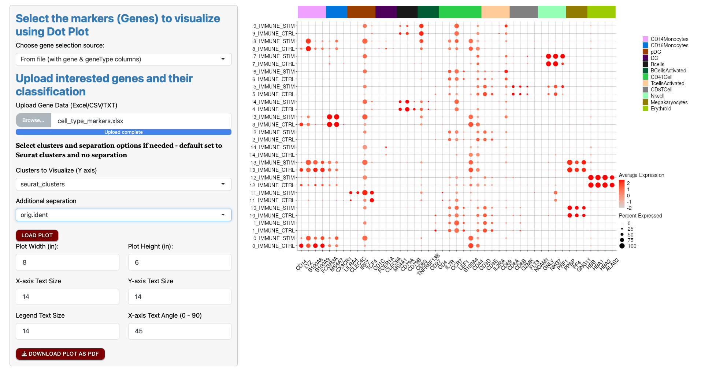

### Step 6: Annotate clusters (Additional Option)

**Goal:** Add a new metadata column with cell type names for each cluster.

1. Go to **Cell Summary Profile** > **Samples Description** and click **Select** under **Additional Option**.
2. In **Select metadata column**, choose `seurat_clusters`.

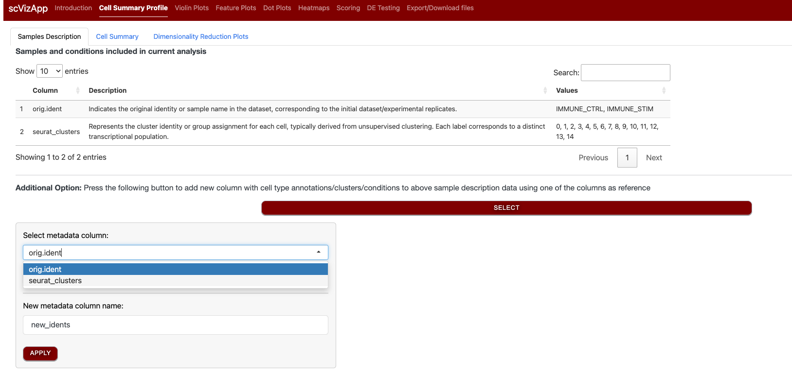

3. Click **Load Column Values**. The app lists every level (0–14) in a text box.
4. Type the cell type name for each cluster, based on the marker expression from Steps 3–5. For example:

   | Cluster | Cell type |
   |---|---|
   | 0 | CD14Mono |
   | 1, 2 | CD4Tcells |
   | 3 | CD16Mono |
   | 4 | Bcells |
   | 5 | CD8Tcells |
   | 6 | Tcells |
   | 7 | NKcells |
   | 8 | DCs |
   | 9 | BcellsActv |
   | 10,13 | Mks (Megakaryocytes) |
   | 11,14 | pDCs |
   | 12 | Eryth (Erythrocytes) |

   Continue through the remaining clusters. Clusters sharing a name are merged into one cell type.
5. Go back to cell summary profile and now access **Additional Feature** option to annotate identified clusters based on comparative Dot Plot.
6. Enter a **New metadata column name** (for example `cellTypeAnnotation`) and click **Apply**.

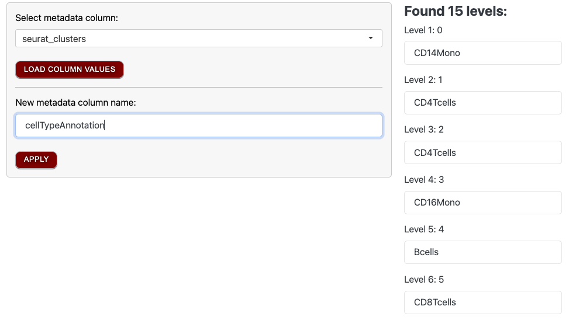

7. The new column now appears in the Samples Description table and is available in every dropdown in the app.

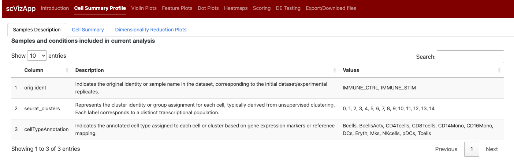

### Step 7: Module Scoring

**Goal:** Score interferon signaling activity per cell and compare Control vs stimulated samples.

1. Open the **Scoring** tab. Under **Choose gene selection source**, select **From file (with gene column)**.
2. Click **Browse** and choose `demo_data/REACTOME_INTERFERON_SIGNALING.v2026.1.Hs.gmt`. Wait for **Upload complete**. (Excel, CSV, TXT and GMT files are accepted.)
3. Set **Clusters to Visualize** to `cellTypeAnnotation` and **Additional separation** to `orig.ident`.
4. Click **Load Plot**. Each UMAP shows the per-cell score, with Control on the left and stimulated on the right, so you can see which cell types respond most strongly to stimulation.

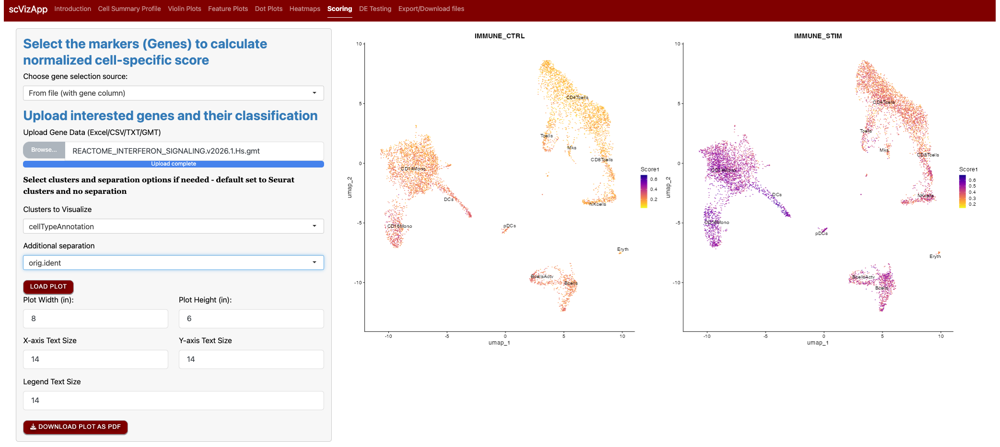

### Step 8: Differential Expression

**Goal:** Find genes that change between stimulated and Control samples.

1. Open the **DE Testing** tab.
2. Set **Select Cluster for Differential Expression Testing** to `orig.ident`.
3. Set **Comparison Category 1** to `IMMUNE_STIM` and **Comparison Category 2** to `IMMUNE_CTRL`.
4. Click **Load DE Table**. The results table (log2 fold change, percent expressed, adjusted p-value) and an interactive volcano plot appear. Upregulated genes are red, downregulated genes are blue, and the top genes are labeled.
5. Click **Download Table as CSV** to save the results.

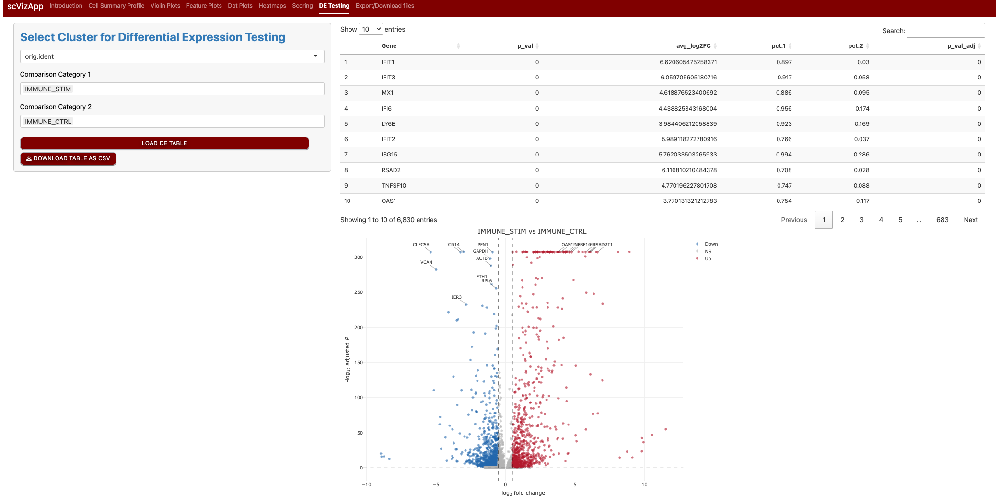

### Step 9: Export results

**Goal:** Save the new annotations for later use.

1. Open the **Export/Download files** tab.
2. Click **Download Metadata** to save the updated metadata table (including `cellTypeAnnotation`) as a TSV file.
3. Click **Download RDS File** to save the Seurat object with the new column.

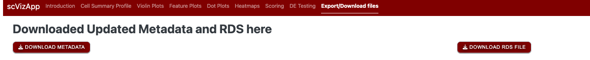

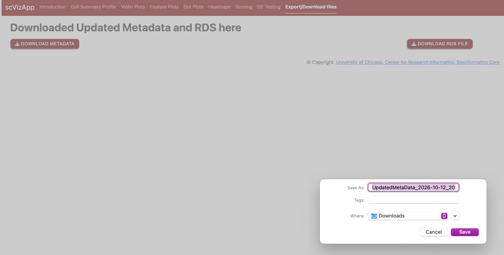

---
